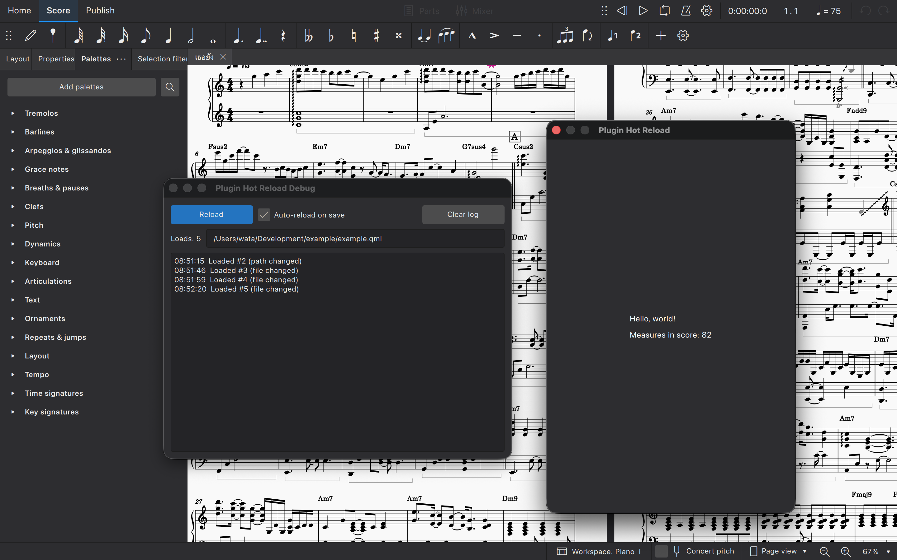

# Plugin Hot Reload

> [!WARNING]
> **Vibe coded** and only tested on macOS. Use at your own risk.

A live-reload host for developing MuseScore 4 plugins.

Edit your plugin's QML file, save, and it reloads inside MuseScore within
about half a second. No restarting MuseScore, no re-running the plugin.

- The **dialog** shows only your plugin, at its real size, so it looks like the finished product.
- A separate **debug window** shows compile errors, a log, and reload controls.



## Requirements

- MuseScore 4.4 or newer. For 4.0 to 4.3, see [Older versions](#older-versions).
- Developed on macOS. Windows and Linux are untested, so reports are welcome.

## Installation

1. Download `PluginHotReload.qml`.
2. Put it in your MuseScore plugins folder (by default `Documents/MuseScore4/Plugins`).
3. In MuseScore, open **Plugins → Manage plugins** and enable **Plugin Hot Reload**.
4. Open `PluginHotReload.qml` in a text editor and set `width` and `height` near the top to match your plugin's dialog size.

## Usage

1. Run **Plugin Hot Reload** from the Plugins menu. The dialog and the debug window open.
2. In the debug window, enter the full path to your plugin's `.qml` file and press Enter.
3. Edit and save your file. It reloads automatically.

Keep the file you are developing **outside** MuseScore's Plugins folder.
Otherwise MuseScore lists it as a plugin too.

### Debug window

| Control | What it does |
| --- | --- |
| Path field | The file to load. Quotes and `file://` are stripped, so you can paste a path straight from Finder or a terminal. |
| Reload | Reloads the file now. |
| Auto-reload on save | Reloads whenever the file's content changes. |
| Clear log | Empties the log. |
| Error banner | Shows compile errors with line numbers, and errors thrown in `run()` and `dispose()`. |

### Reopening the debug window

If you close the debug window, press this in the dialog:

| Platform | Shortcut |
| --- | --- |
| macOS | `Control+D` or `F12` (`F12` may need `Fn`) |
| Windows / Linux | `Ctrl+Shift+D` or `F12` |

## Writing the file you load

The file you load (the "target") must follow these rules:

- Its root element must be an `Item` (or something that inherits from it, such as `Rectangle` or `ColumnLayout`). It must **not** be a `MuseScore { }` element, because it is loaded inside this host's dialog.
- It must contain its own `import` lines.
- Optional: `function run()` is called after every load or reload.
- Optional: `function dispose()` is called before every unload or reload, so you can clean up timers and connections.

Minimal example:

```qml
import QtQuick 2.15

Rectangle {
    color: "#2b2b2b"

    function run() { console.log("loaded") }
    function dispose() { console.log("unloading") }

    Text {
        anchors.centerIn: parent
        color: "white"
        text: "Hello from the target"
    }
}
```

## Limitations

- Only the loaded file is watched. If it imports other QML files and you edit those, press **Reload**.
- Launching the plugin a second time opens a second host. Close the first dialog before relaunching.
- The path is not remembered between runs.

## Older versions

For MuseScore 4.0 to 4.3, in `PluginHotReload.qml` change:

- `import Muse.Ui 1.0` to `import MuseScore.Ui 1.0`
- `import Muse.UiComponents 1.0` to `import MuseScore.UiComponents 1.0`

This is untested on those versions.

## Notes

On macOS the debug window uses a stay-on-top dialog so that it can appear in front of MuseScore when MuseScore is in full screen.

## License

MIT. See the [LICENSE](LICENSE) file.